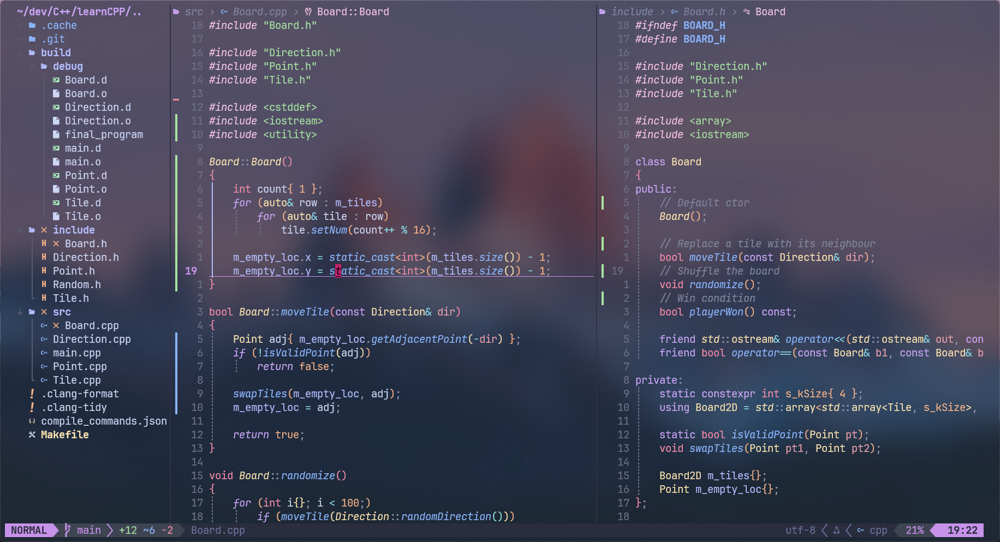

Dotfiles
========

My own small, opinionated set of personal dotfiles for a developer-focused terminal environment. It is tailored for a fast Bash workflow, a polished Git setup, and a modular Neovim configuration.

## Overview

This repository contains the following configuration files:

- `bash/bashrc` -- shell startup configuration, aliases, fzf integration, and prompt/tool setup
- `git/gitconfig` -- Git defaults, aliases, signing, and diff/commit preferences
- `nvim/` -- Neovim configuration with lots of plugins
- `bat/config` -- `bat` syntax-highlighting defaults

## Installation

From the repository root, create the symlinks you need:

```bash
# Bash
ln -sf "$PWD/bash/bashrc" ~/.bashrc

# Git
ln -sf "$PWD/git/gitconfig" ~/.gitconfig

# Neovim
mkdir -p ~/.config
ln -sfn "$PWD/nvim" ~/.config/nvim

# Bat
mkdir -p ~/.config/bat
ln -sfn "$PWD/bat/config" ~/.config/bat/config
```

Then reload the shell

```bash
source ~/.bashrc
```

## Included tooling and configuration

### Bash

- useful aliases like `ll`, `ls`, `tree`, `lg`
- `fzf` integration with preview support
- `fd` based path completion
- `eza` for richer `ls` output
- `bat` previews for files and directories
- `oh-my-posh` prompt initalization
- Homebrew and pyenv environment setup

### Git

- default branch set to `main`
- editor set to `nvim`
- `delta` as the pager
- auto-prune fetch and auto-setup remote push
- useful bunch of aliases
- commit signing via SSH key configuration

### Neovim

Modular and deeply organized Neovim configuration optimized for transparent background. It contains a collection of plugin and core configs, including UI, LSP, completion, diagnostics, and git integration. It already preinstalls some LSPs and linters, so make sure to readjust that based on your needs through `Mason` or directly at `$PWD/nvim/lua/alisvim/plugins/lsp.lua`.



### Bat

The `bat` config customizes theme and output style to make terminal file previews cleaner and more readable.

## Requirements

This setup assumes the followings are available on your system:

- Bash
- Git
- Neovim (v0.12+)
- [fzf](https://github.com/junegunn/fzf)
- [fd](https://github.com/sharkdp/fd)
- [eza](https://github.com/eza-community/eza)
- [bat](https://github.com/sharkdp/bat)
- [delta](https://github.com/dandavison/delta)
- [lazygit](https://github.com/jesseduffield/lazygit)
- [oh-my-posh](https://github.com/jandedobbeleer/oh-my-posh)
- [pyEnv](https://github.com/pyenv/pyenv) (Comment out if you don't use it)
